# GIM Campus Buddy: Product Case Study

> One place for students at the university to discover campus events, follow clubs, and find regional communities, and for clubs to publish and manage those events.

**Context:** End-term project, MBA (Marketing)
**Stage:** Early pilot, live PWA
**Stack:** Vercel · Node.js serverless API · MongoDB · Vanilla JS Progressive Web App · Mixpanel
**Research:** 12 interviews with students and club members

*This repo is a case study. The source code is private.*

---

## 1. The Problem

Students at GIM have no single place to find out what is happening on campus. Event information is scattered across WhatsApp groups, posters and word of mouth, so students keep missing events they would have joined. The problem is sharper for students from other states, who also struggle to find people from their own region.

Clubs have the mirror-image problem. To reach students they have to maintain several channels, and they have no reliable way to see who is interested or who registered.

## 2. Who It's For

| User | What they need |
|---|---|
| **Students** | See all upcoming events in one place, get relevant recommendations, register quickly, find regional and interest communities |
| **Clubs and student bodies** | Publish events once, reach the right audience, manage registrations, keep members informed |

[Add your final personas and Jobs-to-be-Done table here. They're in the project doc.]

## 3. Product Vision & Principles

**Vision:** Connect every student with events, communities and campus opportunities, seamlessly and inclusively.

| Principle | What it means in the product |
|---|---|
| **Centralized communication** | One platform instead of many WhatsApp groups |
| **Student-first design** | Simple, mobile-first, installable like an app |
| **Relevant updates** | Events and reminders matched to the student's interests |
| **Inclusivity** | Anyone can find communities by interest *or* home region |
| **Scalability** | Built so other institutions could be added later |

---

## 4. The Solution

**Student app (PWA)**
- A "For You" feed of recommended events plus an "Explore" tab for everything else
- Event pages with date, venue, seats left and registration count
- One-tap registration and unregistration
- Live event chat for registered attendees
- Follow clubs and join regional communities
- Interest-based personalization chosen during sign-up

**Club portal**
- Club sign-up, then an admin approval step before anything goes live
- Event creation with date, venue and seat limits
- Event management: view registrations, see the attendee list, mark an event ended, or delete it
- Lightweight analytics tab: total events, registrations, unique attendees, average per event, plus attendee interests and regions

### Screens

**Onboarding:** sign-in, then a 3-step sign-up that collects details, interests (minimum 5) and optional clubs to follow

| Sign in | Step 1: Details | Step 2: Interests | Step 3: Follow clubs |
|---|---|---|---|
| 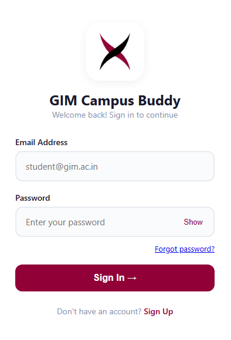 | 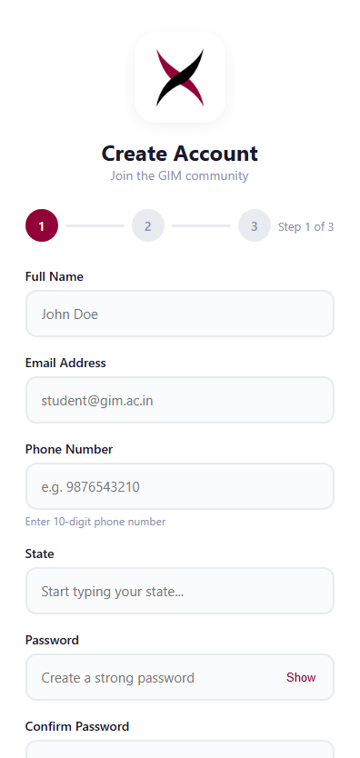 | 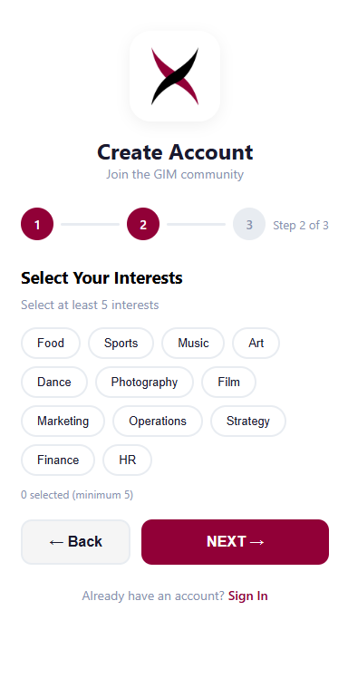 | 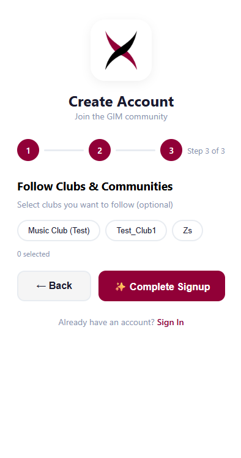 |

**Core experience:** personalized feed, event page and live chat

| Home: "For You" | Event detail | Live event chat |
|---|---|---|
| 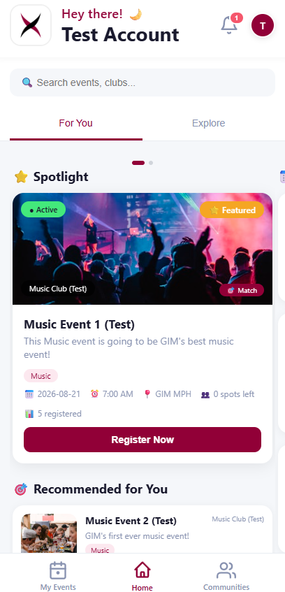 | 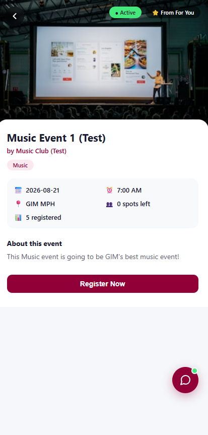 | 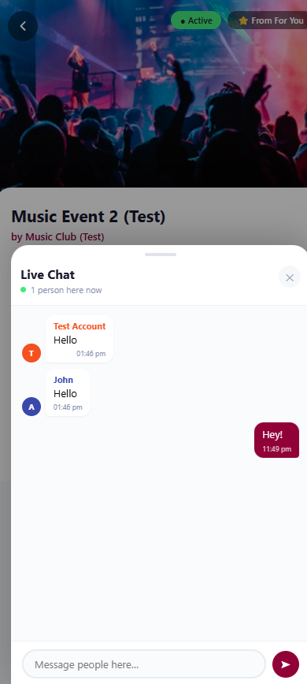 |

**Club portal:** sign-in, approval gate, event management and analytics

| Club sign-in | Pending approval | Event management | Analytics |
|---|---|---|---|
| 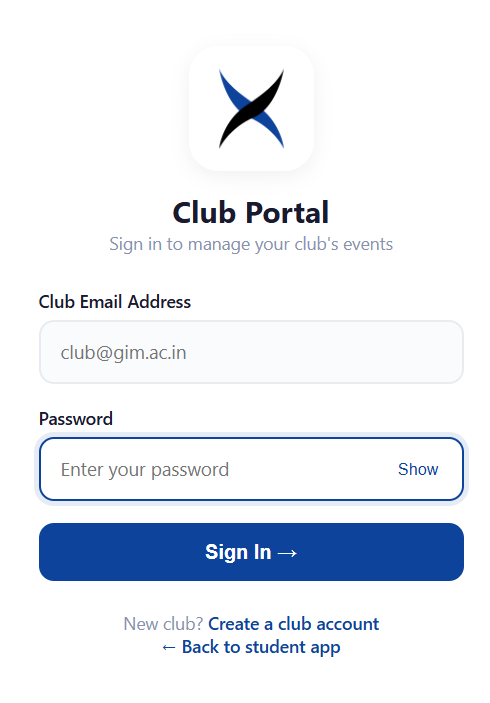 | 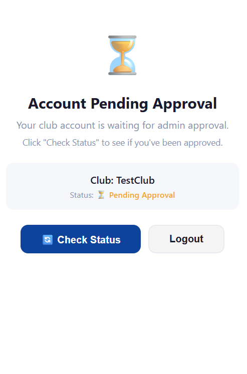 | 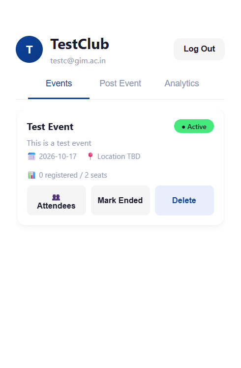 | 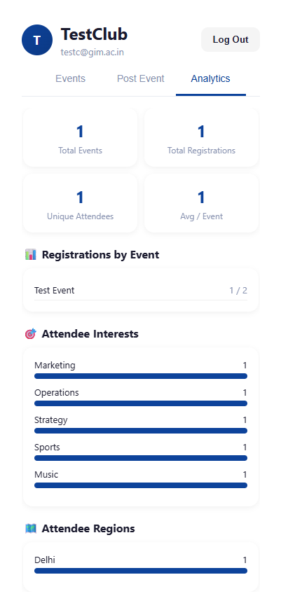 |

*All screens show test accounts and test events.*

---

## 5. Key Product Decisions & Trade-offs

I treated scope as the main product decision. The MVP had to prove one thing: **will students use a single platform instead of WhatsApp and word of mouth?**

**In scope (and why)**

| Feature | Rationale |
|---|---|
| Event discovery hub | Directly solves the core pain of missing events |
| Authentication and profiles | Needed for personalization and future community features |
| Club directory and follow | Builds belonging and gives retention a hook |
| Club event management | Gives clubs a reason to publish here instead of on other channels |
| Event registration | Gives clubs real participation numbers |
| Notifications and reminders | Reduces missed events |
| Event discussion chat | Supports coordination, kept limited because of moderation cost |

**Out of scope (and why)**

| Feature | Why it was cut |
|---|---|
| Full user-to-user chat | Existing apps already cover this and it adds heavy moderation work |
| Comments | Less valuable than event chat and needs more moderation |
| AI-based recommendations | No behavior data yet. Used simple interest matching first |
| Gamification | Doesn't solve discovery. Add after adoption |
| Advanced club analytics | A lightweight analytics tab shipped (registrations, attendee interests and regions). A full dashboard is deferred until clubs prove they use it |

**Other decisions**
- **College-email sign-up** keeps the community closed and trusted.
- **Admin approval for clubs** protects students from spam and fake events.
- **Chat limited to registered attendees** to keep moderation manageable.
- **PWA instead of a native app** removes app-store friction: students install from a link or QR code.

---

## 6. Go-to-Market

**Market sizing (GIM only)**

| | Size | Basis |
|---|---|---|
| TAM | 1,380 | All GIM students |
| SAM | 700 | About 50% of TAM |
| SOM | 225–250 | About 33% of SAM, the realistic first-year target |

**Positioning:** a campus engagement platform. It matches competitors on event listings, notifications, community groups and student profiles. It differentiates with personalized recommendations, regional communities, centralized announcements, event reminders and interest matching, replacing several communication channels with one.

**Channels:** *Primary:* student council, club coordinators, orientation sessions, QR codes, classroom demos, WhatsApp. *Secondary:* Instagram, email.

**Pricing:** Free for students and clubs. *Future:* per-institution licensing (B2B SaaS).

[Add your competitor analysis, OKRs and roadmap here.]

---

## 7. Early Results & What the Data Showed

I instrumented the student app with Mixpanel from the first release.

> **Honest note on the data:** this is an early pilot with small numbers, and it includes my own test accounts and test events ("Music Event 1/2 (Test)"). I treat all of it as directional, not proof of adoption.

| Metric | Result |
|---|---|
| Landing-page visitors → unique sign-ups | 19 → 13 |
| Sign-up funnel completion (4 steps) | 64.7% (17 started → 11 completed) |
| Registrations across two test events | 8 registered, 5 un-registered |

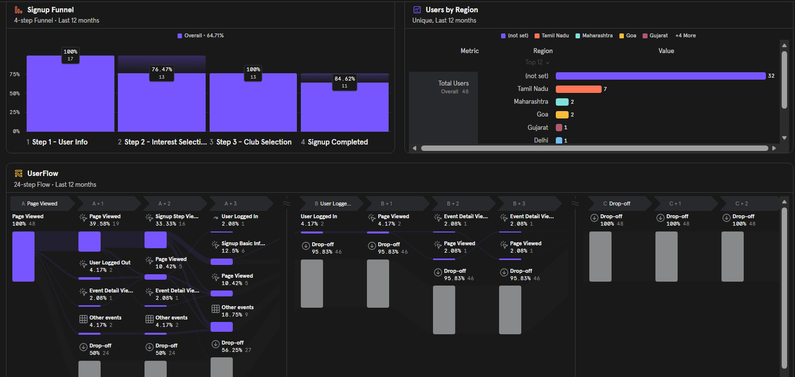
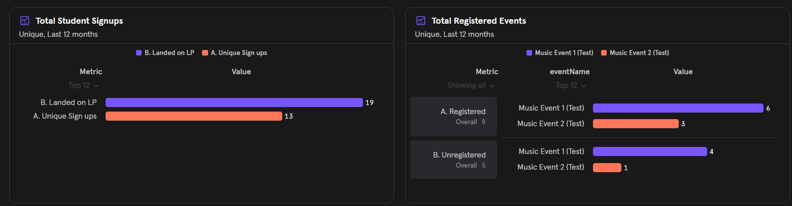

**What I learned**

1. **Step 1 of sign-up is the biggest leak.** 4 of 17 people (about 24%) dropped after the first screen, which asks for name, email, phone, state, a password and three security questions. After that, flow is healthy: everyone who reached club selection continued from interests, and about 85% completed. *Next move:* shorten step 1 by deferring the security questions and phone number.
2. **Personalization is cheap to collect up front.** People didn't abandon at the interest-selection step, so asking for interests during sign-up is not a barrier.
3. **Regional communities have early support.** Of the 16 users who set a state, 7 are from Tamil Nadu and only 2 from Goa. Many students are far from home, which is the group the regional-community feature is meant to serve. Directional only, given the small sample.
4. **The core loop works.** Registration, un-registration and live chat were all used, and one test event filled its seat cap.
5. **Retention is the open question.** Only a couple of returning logins showed up, so I can't yet say whether students come back. A real club-led pilot is the next test.

---

## 8. Risks & Open Questions

| Risk | Mitigation |
|---|---|
| Students already rely on WhatsApp. Will they switch? | Pilot with a few active clubs, gather feedback before scaling |
| Clubs may not keep event details current | Event owners are verified club reps. Events expire |
| Outdated or wrong event info | Expiry dates and a confirm-before-publish step |
| Chat gets hard to moderate | Chat limited to registered attendees. Reporting tools later |
| Getting clubs onboarded | Onboarding sessions with coordinators, a simple event-creation flow, and an approval screen that tells new clubs exactly where they stand |
| Notifications: real-time or scheduled? | Start with basic reminders, test preferences before adding more |

**MVP success metrics:** active users, events created, event registrations, club participation, student engagement.

---

## 9. What I'd Do Next

1. Run a controlled pilot with 3–5 clubs and measure week-2 retention
2. Shorten sign-up step 1 and re-measure the funnel
3. Add event reminders and push notifications
4. QR check-in to measure actual attendance, not just registration
5. Strengthen authentication and admin controls before wider rollout
6. Explore institution licensing once usage is proven
